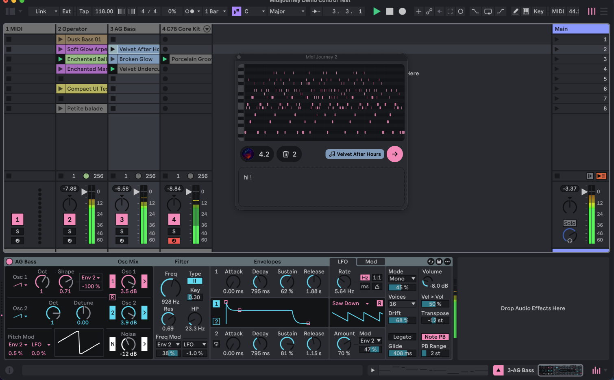

# MIDI Journey 2

[](https://pollinations.ai/?ref=badge)

Compose MIDI through conversation, bring a selected clip into the chat, and turn
ideas into clips in Ableton Live. MIDI Journey 2 adds a piano-roll preview,
automatic Ableton Live theme matching, browser sign-in, and a self-contained Max for Live device.

Powered by [Pollinations.ai](https://pollinations.ai/). Connect your own Pollinations
account to generate MIDI using your Pollen balance.



## Downloads

[Download ZIP](https://github.com/pollinations/MIDIjourney/releases/download/v3.1.0/MIDI-Journey-2.zip) · [Release notes](https://github.com/pollinations/MIDIjourney/releases/tag/v3.1.0). Unzip and load **MIDI Journey 2.amxd** on Main in Live.

Current release: **MIDI Journey 2 · 3.1.0**.

## The Pollinations agent

The device uses the existing hosted **D1 prompt-based MIDIjourney agent**,
`community/pollinations-ai/midijourney`, through the Pollinations SDK. Its prompt,
model configuration, MCP tools and multi-step execution remain managed by
Pollinations. The device calls this hosted agent directly.

You can ask the agent to use another supported model. Execution depends on its
available tools and models; naming a model alone is not proof that it was used.
Multi-step tool execution is managed by the hosted agent.

Sign in with your own Pollinations account. The welcome message and supported
exact transpositions run locally; other requests use your Pollen balance.
An agent request can involve multiple model/tool calls. No personal token is
embedded in the device.

## Use

1. Load one frozen **MIDI Journey 2.amxd** on **Main**.
2. Use **Open chat** in the compact device panel. When signed out, **Connect** appears on the left of the floating chat and opens the normal Pollinations login and registration flow. Send and Trash remain visible but disabled; you can still edit your draft. Reconnecting preserves the conversation and generated MIDI. Once connected, your avatar and available Pollen replace Connect: click the avatar for your dashboard, or the amount to manage this app's key. The device keeps Open chat, the centered balance explanation, and a pollinations.ai link.
   The device and chat use Live's semantic theme colors throughout: active controls, text, surfaces, focus, MIDI display and scrollbars. There is no fixed MIDI Journey 2 accent. The selected MIDI badge retains the clip's own color.
3. Click **Connect**, finish signing in through your system browser, and return to Live.
4. Describe your musical idea. A selected MIDI clip appears as an input badge; its notes are read again when you send.
5. Select a Session MIDI clip or empty slot and click a generated **MIDI preview**.

**Creating replaces an existing selected clip's notes, title and length, or fills the selected empty slot.** Other clips stay unchanged. Recording clips cannot be replaced. Output never redirects to a different slot.

The editor stays open while you change Live's selection. Each device load starts a fresh chat. Hiding and reopening the same window keeps the conversation; **Trash** beside Send clears it without deleting Live clips or signing out. Use Command-C/V/X/A and Command-Z/Shift-Z for native editing; the right-click menu also works. The window stays visible when Live loses focus. Controls have accessible labels and disabled-state descriptions without hover tooltips. Detailed write verification goes to the console; the chat shows a short failure message.

Resize the chat window directly; there is no expand/collapse button. Below 520 px of content height, it shows the latest MIDI and a three-line prompt. At 520 px and above, it shows the conversation and a six-line prompt. Each newly loaded device starts with a 420 × 550 window. Closing and reopening that editor preserves its exact size and position; loading another device starts fresh. Width stays between 420 and 720 px. Both prompts scroll vertically for longer text and preserve line breaks during resizing. Connect or the account pill sits on the left above the text-only border; the clip-colored MIDI badge, Send, and Trash sit on the right. Buttons retain their round styling and Live theme colors. Trash shows the number of generated MIDI clips in the chat; when none exist, its number is hidden and the control is disabled. Each MIDI preview is a write button, including earlier replies in the conversation. Hover or keyboard focus reveals “Write to selected empty slot” or “Replace selected clip,” according to the current Live destination, over a softly blurred preview; clicking writes that reply to Live. Resizing preserves the conversation and draft.

## Requirements

- macOS, regular **Ableton Live 12 with Max for Live**, and **Max 9.1.5+**. The current validation target is Live 12.4.6 with **Use bundled Max** selected in Live's settings. Live Beta is not required.
- Internet access and a Pollinations account with Pollen.
- One device instance; local port **5178** must be free.

The connector is a transparent Max Audio Effect on Main, using Live's Object Model to access MIDI tracks. Input follows one selected MIDI clip; output targets Session View. Windows and automatic multi-selection are not supported for this release. Acceptance covers the tested setup; version requirements are not a guarantee for every Live version or add-on.

## Develop

Use Node **22.12+** and npm from the repository root:

```sh
npm ci
npm run verify
npm run dev
```

The browser preview cannot modify Live. Stop it before loading the device: both use port 5178. `npm run test:ui` serves isolated fake-account/provider fixtures on port 5186; they never ship in the device.

```text
app/      React UI and browser fixtures
core/     Agent requests, MIDI validation and conversation context
device/   Max LiveAPI bridge, embedded server and native window controls
scripts/  Build, native-freeze staging and artifact verification
vendor/   Pinned Pollinations UI package and license provenance
docs/     Privacy, troubleshooting and release checklist
```

Generation uses the managed `community/pollinations-ai/midijourney` agent through `@pollinations/sdk`. Native YAML/CSV and valid JSON responses are validated locally before use. The app does not send structured-output options or choose the agent's underlying model. The shared UI and theme system come from `@pollinations/ui`; see [dependency provenance](vendor/README.md).

Build configuration uses `MIDIJOURNEY_POLLINATIONS_APP_KEY` or the existing ignored `js/config.release.js`. That directory contains local configuration only. Builds never create or rotate keys. A key-free checkout builds a configuration-required screen; release preparation requires a configured publishable app key. Never commit personal tokens or local configuration.

## Build and freeze

Native macOS keyboard/window support requires Xcode command-line tools and
`MAX_SDK_PATH` pointing to the official Max SDK headers; see
[the native component build instructions](device/native/README.md).


```sh
npm run verify
npm run release:prepare
# Load the printed candidate in Live on Main; Edit in Max → Freeze Device → Save.
npm run release:verify -- "/path/to/MIDI Journey 2.amxd"
npm run release:package -- "/path/to/MIDI Journey 2.amxd"
```

`dist/` contains editable source output, not a frozen release. Preparation creates an isolated temporary Max project. The frozen device embeds all four runtime scripts and the native keyboard/window component, with web assets/fonts inside the server bundle. It requires no Node or dependency installation inside Live.

The macOS native component is ad-hoc signed, without Developer ID signing or notarization. macOS may block it after download; the release does not require disabling Gatekeeper.

Packaging creates `release/MIDI-Journey-2/` and its ZIP with the verified device, installation guide, license, third-party notices and checksums. It refuses to overwrite an existing package. Release output is ignored by Git.

Verification checks the native container, embedded bytes, patch connections and UI against the current build. It does not prove Live behavior. Complete the [release checklist](docs/RELEASE_CHECKLIST.md) before publishing; do not distribute a stale candidate after source changes.

[Troubleshooting](docs/TROUBLESHOOTING.md) · [Privacy](docs/PRIVACY.md) · [Changelog](CHANGELOG.md)

## Credits

Created by Elliot Fouchy and Thomas Haferlach at Pixelynx's KORUS Labs, with artistic direction from Richie Hawtin and deadmau5. Powered by [Pollinations](https://pollinations.ai/). [MIT License](LICENSE).
